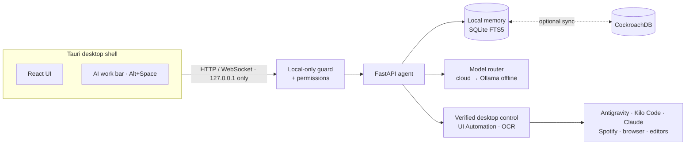

# AUTOMATA

**A local-first AI development workspace for Windows.**
AUTOMATA runs quietly in your tray, remembers what you did on every project,
understands each project's stack, and hands work to AI coding agents —
Antigravity, Kilo Code, Claude, Cursor — with your approval at every risky step.
It keeps working offline on a local model.

[](https://github.com/AkankshuGuleria/SMART_AUTOMATOR/actions/workflows/ci.yml)


---

## Highlights

| | |
| --- | --- |
| **Remembers your work** | Edits, commits, terminal commands, chats and decisions in a local memory that works offline. Ask *"what did I change in the auth code?"* and get an answer with sources. |
| **Picks up where you left off** | A morning brief, and **Resume** reopens the editor you actually used for that project — Antigravity IDE, VS Code or Cursor — with your recent files, terminal and dev servers. |
| **Understands each project** | Detects the stack, run/build/test commands, ports, required environment variables and modules from the project's own files. |
| **Delegates to AI agents** | *"open antigravity and use kilo code to build my portfolio"* → asks where to save it and what you want → writes a grounded prompt → delivers it to the agent's chat box (confirmed by read-back) → watches the agent work → runs the build → lists the API keys you still need. |
| **AI work bar** | Press **Alt+Space** anywhere: ask, command, play music on Spotify, search the web, or have it read and explain the window you're looking at. |
| **Asks before it acts** | Opening apps, typing, music, screen reading, Resume and commands all ask first: *Allow once / Always allow / Deny*. |
| **Offline by default** | Cloud models when available (Groq, OpenRouter, Gemini, Cohere, NVIDIA, MiniMax, Bedrock), a local Ollama model when not. |
| **Knows your machine** | CPU / GPU / RAM / disk, top processes, and where your time goes by app. |

## How it works



The Python agent owns all data, model calls and desktop actions; the UI only
talks to it over `127.0.0.1`. Details: [docs/ARCHITECTURE.md](docs/ARCHITECTURE.md).

## Quick start

**Requirements:** Windows 10/11, Python 3.12 + [uv](https://docs.astral.sh/uv/),
Node.js 20+. Rust stable only to build the desktop app. Everything else
(Ollama, cloud API keys, CockroachDB) is optional.

```powershell
git clone https://github.com/AkankshuGuleria/SMART_AUTOMATOR.git
cd SMART_AUTOMATOR
cd backend;  uv sync --extra dev; cd ..
cd frontend; npm ci;              cd ..
.\scripts\dev.ps1                 # agent + UI → http://localhost:5173
```

Desktop app (tray, start at sign-in, work bar, starts the agent for you):

```powershell
cd frontend
npx tauri build --no-bundle       # → src-tauri\target\release\app.exe
```

Then open **Setup & health** to see what is configured and fix anything missing.
To add cloud models or the cloud memory copy, copy `backend/.env.example` to
`backend/.env` and fill in only what you use.

## Using it

| Say (chat or work bar) | What happens |
| --- | --- |
| `what did I work on yesterday?` | Answer from your project memory, with sources |
| `using antigravity add a contact form` | A delegation task: questions → prompt → your approval → hand-off → build → report |
| `play lofi beats on spotify` · `next song` · `volume down` | Media control (asks permission the first time) |
| `search tauri tray on github` | Opens the search in your browser |
| `explain the error on my screen` | Reads the window behind AUTOMATA (OCR) and explains it |
| `what windows are open` · `switch to the github tab` | Window and tab control, verified |

More in the [user guide](docs/USER_GUIDE.md).

## Security

- The agent listens on `127.0.0.1` only and refuses requests from other
  websites and DNS-rebinding attempts.
- Every action that controls your PC asks first; approvals are single-use.
- Secrets live in `backend/.env` (git-ignored) or Windows Credential Manager —
  never in AUTOMATA's databases, logs or prompts. Captured text is redacted.
- The desktop app runs under a strict Content Security Policy.
- Latest audit: 0 known vulnerabilities in Python, npm and Rust dependencies;
  0 high-severity static-analysis findings; no secrets in git history.

See [docs/SECURITY.md](docs/SECURITY.md) and the [security audit](docs/SECURITY_AUDIT.md).
To report a vulnerability, follow [SECURITY.md](SECURITY.md).

## Development

```powershell
cd backend;  uv run pytest tests/ -q;  uv run ruff check .
cd frontend; npx tsc -b; npx oxlint src; npm test; npm run build
```

The same checks, plus dependency audits, run in CI on every push and pull
request. Tests never touch your real database, model providers, keyboard or
screen. Start with [docs/AGENTS.md](docs/AGENTS.md) and
[CONTRIBUTING.md](CONTRIBUTING.md).

```text
backend/    Python agent — api, security, memory, ai, automation, tasks, assist, …
frontend/   React UI and the Tauri desktop shell (src-tauri/)
docs/       documentation — index at docs/README.md
scripts/    dev.ps1 and small utilities
```

## Documentation

| | |
| --- | --- |
| [User guide](docs/USER_GUIDE.md) | Using every feature |
| [Development guide](docs/DEVELOPMENT.md) | Setup, configuration, tests, desktop build |
| [Architecture](docs/ARCHITECTURE.md) · [API](docs/API_REFERENCE.md) · [Data](docs/DATABASE_SCHEMA.md) | How it is built |
| [Project status](docs/PROJECT_STATUS.md) · [Roadmap](docs/ROADMAP.md) · [Changelog](CHANGELOG.md) | Where it stands |
| [All documentation](docs/README.md) | Full index |

## Scope

AUTOMATA is built for one developer on one Windows machine. It is not a hosted
or multi-user service; do not expose the agent's port to a network.
